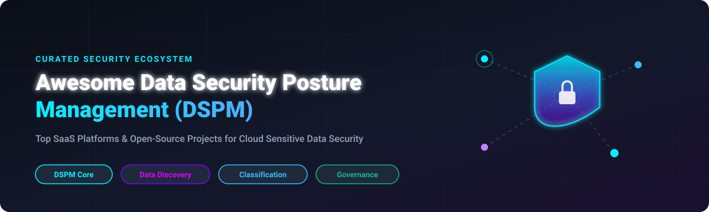

  

  
  
  
  
  

# 🛡️ Awesome Data Security Posture Management (DSPM)

> **A curated ecosystem of commercial SaaS platforms and open-source GitHub projects for Data Security Posture Management (DSPM), Sensitive Data Discovery, PII Classification, Data Access Governance, and Data Risk Prioritization.**

---

## 📌 Table of Contents

- [🌐 Market Overview & Sector Analysis](#-market-overview--sector-analysis)
- [🏢 SaaS/Hosted Platforms](#-saashosted-platforms)
- [🔓 Open-Source GitHub Projects](#-open-source-github-projects)
- [🤝 How to Contribute](#-how-to-contribute)
- [☕ Support & Sponsorship](#-support--sponsorship)
- [📈 Star History](#-star-history)
- [⚠️ Disclaimer](#-disclaimer)

---

## 🌐 Market Overview & Sector Analysis

The global **Data Security Posture Management (DSPM)** market size is estimated at **$2.8 Billion in 2026** and is projected to reach **$11.5 Billion by 2032**, expanding at a **CAGR of ~26.5%**. The sector is currently **moderately fragmented**, characterized by high-growth specialized venture-backed innovators (such as Cyera, BigID, Securiti) competing against major cloud security platforms and CNAPP consolidators (including Microsoft, Palo Alto Networks, Wiz, Rubrik, and Qualys).

---

## 🏢 SaaS/Hosted Platforms

The table below lists top commercial SaaS DSPM platforms, sorted descending by **Company Size (Valuation / Revenue)**.

| SaaS Platform | Description & Key Capabilities | Company Size (Valuation / Revenue) 🔽 | Starting Tier Pricing | Free Tier / Free Trial Limits |
| :--- | :--- | :--- | :--- | :--- |
| 🔷 **[Microsoft Purview DSPM](https://www.microsoft.com/en-us/security/business/microsoft-purview)** | Native DSPM and data security suite across M365, Azure, and multi-cloud repositories. Provides sensitive data discovery, classification, and access risk monitoring. | **~$3.1 Trillion** (Market Cap) / **$245B+** Revenue | **$57.00/user/mo** (M365 E5) or **$0.40/10k items** + $1.00/GB scanned | **90-Day Free Trial** (includes up to 25 user licenses with full compliance & DSPM features) |
| 🛡️ **[Dig Security (Palo Alto Networks)](https://www.dig.security/)** | Cloud data security platform providing real-time DSPM and Data Detection & Response (DDR) across multi-cloud infrastructure. | **~$110.0 Billion** (Market Cap) / **$8B+** Revenue | **$12,000.00/year** (Prisma Cloud Data Security module starting bundle) | **30-Day Free Trial** via Palo Alto Prisma Cloud platform (up to 1,000 cloud resources) |
| ⚡ **[Wiz DSPM](https://www.wiz.io/)** | Data security module integrated into Wiz's CNAPP platform. Correlates sensitive data exposure with cloud access permissions via the Security Graph. | **$12.0 Billion** (Valuation) / **$500M+** ARR | **$18,000.00/year** ($1,500/mo base subscription for Wiz platform) | **14-Day Free Trial** (full cloud environment scan up to 500 workloads/buckets) |
| 💾 **[Rubrik DSPM (Laminar)](https://www.rubrik.com/)** | Cloud data security platform (acquired Laminar) offering cloud data discovery, classification, risk prioritization, and shadow data elimination. | **~$7.5 Billion** (Market Cap) / **$800M+** ARR | **$15,000.00/year** base platform license on AWS Marketplace | **14-Day Free Trial** / Rubrik Data Security Risk Assessment (capped at 1 TB scanned volume) |
| 🎯 **[Normalyze (Qualys)](https://normalyze.com/)** | Cloud data security and compliance platform (acquired by Qualys) offering automated data discovery, access graph analysis, and risk remediation. | **~$5.0 Billion** (Market Cap) / **$550M+** Revenue | **$10,000.00/year** starting standalone tier | **30-Day Free Trial** (includes automated cloud asset & data scan up to 25 accounts) |
| 🔮 **[Cyera](https://www.cyera.com/)** | AI-powered DSPM platform leader. Automatically discovers, classifies, and secures sensitive data across multi-cloud environments with access governance. | **$3.0 Billion** (Valuation) / **$100M+** ARR | **$15,000.00/year** ($1,250/mo starter subscription on AWS Marketplace) | **14-Day Free Trial** on AWS Marketplace / 30-Day PoC (up to 500 GB sensitive data scanned) |
| 🔐 **[Varonis](https://www.varonis.com/)** | Data security platform focused on data access governance (DAG) and automated threat detection across hybrid cloud and SaaS data stores. | **~$1.8 Billion** (Market Cap) / **$540M+** ARR | **$12,000.00/year** ($1,000/mo starter subscription tier) | **30-Day Free Trial** (includes full Data Risk Assessment audit report) |
| 📊 **[BigID](https://bigid.com/)** | Data intelligence platform for deep data discovery, ML-driven classification, and privacy compliance (GDPR, CCPA, HIPAA). | **$1.25 Billion** (Valuation) / **$100M+** ARR | **$10,000.00/year** ($833/mo starter subscription on AWS Marketplace) | **30-Day Free Trial** (up to 5 enterprise data sources / 250 GB data scan limit) |
| 🤖 **[Securiti](https://securiti.ai/)** | Unified Data + AI Security platform. Features DataAI Command Graph, LLM Firewall, automated classification tuning, and ROT data reduction. | **~$500 Million** (Valuation) / **$75M+** Funding | **$10,000.00/year** ($833/mo starter platform subscription) | **Free Community Edition** forever (1 data source, max 100 GB scanned) / 14-Day Enterprise Trial |
| 🧠 **[Concentric AI](https://concentric.ai/)** | AI-powered autonomous data security platform delivering semantic understanding for unstructured data discovery and risk identification. | **~$300 Million** (Valuation) / **$67M+** Funding | **$10,000.00/year** starting platform tier | **14-Day Free Trial** (up to 3 data repositories / 100k files scanned) |
| 🛰️ **[Sentra](https://www.sentra.io/)** | Cloud-native DSPM platform focused on Data Detection & Response (DDR) and Data Access Governance (DAG) across IaaS, PaaS, SaaS, and on-premises. | **~$250 Million** (Valuation) / **$53M+** Funding | **$12,000.00/year** starting tier on AWS/Azure Marketplace | **14-Day Free Trial** / 30-Day PoC (up to 10 cloud data stores) |
| 🔍 **[Symmetry Systems](https://symmetry-systems.com/)** | Data security posture platform delivering hybrid cloud data object discovery, granular IAM permission mapping, and data risk visibility. | **~$150 Million** (Valuation) / **$30M+** Funding | **$12,000.00/year** base platform subscription fee | **14-Day Free Trial** (Data Security Posture Assessment trial up to 5 IAM accounts) |

---

## 🔓 Open-Source GitHub Projects

Below is a list of top open-source projects for cloud security posture, PII data classification, vulnerability scanning, and data governance, sorted descending by **GitHub_Stars_Count**.

1. 🦊 **[Wazuh](https://github.com/wazuh/wazuh)** 
   - **Category**: Enterprise SIEM, HIDS & Data Security Monitoring
   - **Description**: Free, open-source enterprise SIEM and security monitoring platform. Provides file integrity monitoring, sensitive data exposure checks, and compliance auditing for GDPR, PCI DSS, HIPAA, and CMMC.

2. 🌐 **[OpenMetadata](https://github.com/open-metadata/OpenMetadata)** 
   - **Category**: Open Data Governance & Metadata Catalog
   - **Description**: Comprehensive open-source data governance platform featuring automated PII sensitive data classification, column-level data lineage, access control policies, and data discovery across multi-cloud databases.

3. 🦉 **[Prowler](https://github.com/prowler-cloud/prowler)** 
   - **Category**: Multi-Cloud Security Posture & Compliance Framework
   - **Description**: The most widely used open-source cloud security posture assessment tool (Apache-2.0). Features **800+ security checks** across AWS, Azure, GCP, Kubernetes, M365, and GitHub, supporting CIS, NIST, PCI DSS, and DORA frameworks.

4. 🛡️ **[Microsoft Presidio](https://github.com/microsoft/presidio)** 
   - **Category**: PII Data Discovery, Anonymization & Protection Engine
   - **Description**: Open-source SDK developed by Microsoft for context-aware identification, classification, and anonymization of Personally Identifiable Information (PII) in structured and unstructured text.

5. 🔎 **[Checkov](https://github.com/bridgecrewio/checkov)** 
   - **Category**: IaC Security & Cloud Posture Static Analysis
   - **Description**: Open-source static code analysis tool for infrastructure-as-code (Terraform, CloudFormation, Kubernetes, Helm). Scans for cloud data store misconfigurations and unencrypted sensitive data targets.

6. ☁️ **[Cloud Custodian](https://github.com/cloud-custodian/cloud-custodian)** 
   - **Category**: CNCF Cloud Posture Rules Engine & Governance
   - **Description**: CNCF open-source stateless rules engine for cloud security and governance. Enables real-time enforcement of cloud data storage encryption, public bucket exposure prevention, and access policies.

7. 🏹 **[Apache Ranger](https://github.com/apache/ranger)** 
   - **Category**: Centralized Data Access Control & Auditing
   - **Description**: Open-source framework to enable, monitor, and manage comprehensive data security across enterprise data lakes. Provides fine-grained access control policies at file, folder, table, and column levels.

8. 📋 **[cnspec](https://github.com/mondoohq/cnspec)** 
   - **Category**: Cross-Cloud Policy & Security Checker
   - **Description**: Open-source security and policy checker built on a security data mesh. Evaluates data security posture and misconfigurations across cloud platforms, Kubernetes clusters, endpoints, and container images.

9. 🕵️ **[OpenKAT](https://github.com/minvws/nl-kat-coordination)** 
   - **Category**: Vulnerability Analysis & Asset Monitoring
   - **Description**: Government-backed open-source vulnerability scanning engine developed by the Dutch Ministry of Health. Integrates 50+ security tools with bitemporal historical audit storage and forensic guarantees.

10. 📄 **[Meta Automated Sensitive Document Classification](https://github.com/facebook/automated-sensitive-document-classification)** 
    - **Category**: LLM-Powered AI Data Leak Prevention (DLP)
    - **Description**: Meta's open-source AI data classification tool using LLMs (Llama) to automatically scan, classify, and label sensitive documents across cloud storage integrations (Google Drive API, Office 365).

11. 🐗 **[data-boar](https://github.com/fabioleitao/data-boar)** 
    - **Category**: Metadata-Only Sensitive Data Scanner
    - **Description**: Compliance-aware personal data discovery tool for GDPR, LGPD, and CCPA. Scans files, SQL, NoSQL, and SharePoint repositories without storing or copying underlying PII data payloads.

---

## 🤝 How to Contribute

Contributions are warmly welcomed! Help make Data Security Posture Management more transparent and accessible:

1. **Fork** this repository.
2. Add or update entries in `README.md` following the standard table/list format.
3. Ensure vendor pricing, free trial parameters, and Stars_Badges remain factual and up-to-date.
4. Submit a **Pull Request** with a descriptive summary of changes.

---

## ☕ Support & Sponsorship

If you find this DSPM curated guide useful for your cloud security architecture, data governance, or compliance research, please consider supporting the project:

- ⭐ **Star** this repository to increase visibility!
- 🔀 **Fork** and share with your security engineering network.
- 💖 **Sponsor / Buy me a Coffee**: Support ongoing open-source maintenance via [GitHub Sponsors](https://github.com/sponsors/ishandutta2007).

---

## 📈 Star History

---

## ⚠️ Disclaimer

- This list is **community-curated** for educational and informational purposes — it is not exhaustive and does not constitute an endorsement.
- DSPM platforms process sensitive cloud data and IAM access policies; verify compliance with GDPR, CCPA, HIPAA, and internal security policies before deployment.
- **Commercial vs. Open Source**: Commercial DSPM platforms provide turnkey AI precision, cross-cloud entity correlation, and automated remediation. Open-source solutions provide robust building blocks for cloud security posture (Prowler), data governance (OpenMetadata, Apache Ranger), and PII scanning (Presidio).
